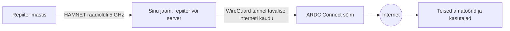

> **Lühidalt:** 44Net (ka **AMPRNet**) on umbes 12 miljonist IP-aadressist koosnev plokk, mis on juba 1981. aastast eraldatud **ainult raadioamatööridele**. Nagu 2 m ja 70 cm ala on meie oma sagedusalad eetris, nii on 44Net meie oma „sagedusala" internetis. Litsentsiga amatöör saab sealt tasuta **püsiva avaliku aadressi** oma jaamale, repiiterile või serverile – ka siis, kui tavaline koduinternet seda ei võimalda.
{.is-info}

# 📡 Mis on 44Net?

Iga internetti ühendatud seade vajab aadressi – **IP-aadressi**. See on nagu kutsung: unikaalne tunnus, mille järgi teised sind üles leiavad. Tänapäeval enim kasutatavas IPv4 internetis on aadresse kokku umbes 4,3 miljardit ja need on ammu otsa saanud. Vaba aadressi eest makstakse turul kümneid dollareid.

1981. aastal, kui internet oli alles teadlaste ja sõjaväelaste tööriist, taipas California raadioamatöör **Hank Magnuski, KA6M**, et arvutivõrgud jõuavad kunagi ka amatöörideni. Ta pöördus toonase interneti numbrite haldaja Jon Posteli poole ja sai amatööridele terve A-klassi võrgu **44.0.0.0/8** – ligi **16,7 miljonit aadressi**. Sestpeale algavad kõik raadioamatööride aadressid numbriga **44** – sellest ka nimi **44Net**.

Vanem nimi **AMPRNet** tuleb ingliskeelsest väljendist *AMateur Packet Radio Network*. See viitab ajale, mil TCP/IP-d kasutati eetris packet-raadio kaudu.

> Kui mäletad 1990ndate packet-raadiot ja postkastisüsteeme (BBS), siis 44Net on sama idee otsene järeltulija – lihtsalt kiirem ja tänapäevasem.
{.is-success}

## Võrdlus raadiomaailmaga

| Raadiomaailmas | 44Netis |
|---|---|
| Kutsung, näiteks ES1ABC | IP-aadress, näiteks 44.x.x.x |
| Amatööridele eraldatud sagedusala (2 m, 70 cm …) | Amatööridele eraldatud aadressiala 44Net |
| Sagedusi koordineerivad TTJA ja IARU | Aadresse haldab mittetulundusühing ARDC |
| Repiiter, mis ühendab jaamu | Lüüs (*gateway*) või ruuter, mis ühendab võrke |
| Kutsungiraamat | DNS – nimi kujul `kutsung.ampr.org` |
| Packet-raadio BBS | Server, veebileht või teenus 44Neti aadressil |

# 🕰️ Lühike ajalugu

| Aasta | Sündmus |
|---|---|
| **1981** | Hank Magnuski, KA6M, saab amatööridele võrgu 44.0.0.0/8 (~16,7 mln aadressi). |
| **1980.–90. aastad** | TCP/IP jõuab eetrisse packet-raadio kaudu; laialt kasutati Phil Karni (KA9Q) tarkvara NOS. |
| **1986** | Jaotusplaan: pool aadressiruumist USA-le, teine pool ülejäänud maailmale. |
| **2011** | Asutatakse mittetulundusühing **ARDC** (*Amateur Radio Digital Communications*), mis võtab aadressiala ametlikult oma hallata. |
| **2019** | ARDC müüb kasutamata veerandi (44.192.0.0/10, ~4 mln aadressi) Amazonile ligikaudu **108 miljoni dollari** eest. Tulu läheb toetusfondi. |
| **2021** | ARDC esimene rahvusvaheline toetus: Saksa ühing DARC saab raha Euroopa HAMNETi laiendamiseks. |
| **2024** | 44Neti portaalis saavad klubid ja ühingud luua **organisatsiooni** ning hallata ressursse ühiselt. |
| **Täna** | Uus lihtne ühendusviis **44Net Connect** toob 44Neti sisuliselt igasse koju. |

> **Miks on 2019. aasta müük oluline?** See näitas kahte asja. Esiteks on aadressiala **väga väärtuslik** – Amazon maksis umbes 25–27 dollarit aadressi eest. Teiseks läks see osa, mille kasutamist amatööride poolt ei nähtud ette, muuks otstarbeks. Parim viis ülejäänud ruumi amatööridele hoida on seda **aktiivselt ja mõistlikult kasutada**.
{.is-warning}

# ⚙️ Kuidas see töötab?

44Net ei ole mingi eraldi „teine internet". See kasutab täpselt samu protokolle nagu tavaline internet. Erinevus on selles, **kellele aadressid on antud ja milleks neid tohib kasutada**.

ARDC ei ole internetiteenuse pakkuja: ta annab aadressid, kuid ühenduse tuleb igaühel ise korraldada – koduinterneti, mobiilse interneti või amatöörraadio lülide kaudu.

## Ühendusviisid {.tabset}

### 44Net Connect (soovitatav)

**Kõige lihtsam ja uuem viis.** Sinu seadme ja ARDC sõlme vahele luuakse krüpteeritud WireGuard-tunnel tavalise interneti kaudu. Tunnel annab seadmele oma 44Neti aadressi ja seade on internetist nähtav nagu tavaline server.

- Töötab ka **CGNAT-i**, mobiilse interneti ja satelliitühenduse taga
- Sobib Windowsile, macOS-ile, Linuxile, Raspberry Pi-le, paljudele ruuteritele ja pilveserveritele
- Seadistamine võtab tavaliselt mõne minuti – portaal annab valmis konfiguratsiooni
- **Vaja on:** portaali kontot, kinnitatud kutsungit, WireGuardi toetavat seadet ja mis tahes internetiühendust

> Connect ei ole „privaatsus-VPN" ega anonüümsuse tööriist. Selle eesmärk on vastupidine: teha sinu jaam avalikult kättesaadavaks.
{.is-info}

### IPIP Mesh

Vanem, kogukonna hallatav võrk ja algse AMPRNeti otsene järeltulija. Iga osaleja käitab oma lüüsi (*gateway*), mis on teiste lüüsidega ühendatud IP-in-IP tunnelite kaudu.

- Nõuab rohkem Linuxi- ja võrguteadmisi
- Vajab tavaliselt avalikku IPv4-aadressi
- Sobib entusiastidele ja klubidele, kellel oskused juba olemas

### BGP (suuremad võrgud)

Kui ühingul või klubil on suurem aadressiplokk (näiteks /24 ehk 256 aadressi), saab internetiteenuse pakkuja või serverimajutaja selle otse internetti välja kuulutada. Nii käitub amatööride võrk nagu iga teine päris võrk internetis.

- See on ühingu ja taristu tasand, mitte koduseadistus
- Vajab koostööd internetiteenuse pakkujaga

### Raadio teel (HAMNET)

44Neti aadresse kasutatakse ka **raadioteel** ehitatud võrkudes. Euroopa tuntuim näide on **HAMNET**: amatööride kiire IP-võrk, kus mastid ja repiitrijaamad on omavahel seotud **13, 6 ja 3 cm** lainealade raadiolülidega.

- 2016. aastaks oli HAMNETil Kesk-Euroopas ligi **4000 sõlme**
- Kasutatakse tavalisi kommertsraadioseadmeid, mis töötavad amatööride sagedustel
- Raadiolülidel kehtivad tavalised amatöörside reeglid

# 🛠️ Milleks see hea on?

## Tüüpilised mured, millele 44Net vastab

| Mure | Kuidas 44Net aitab |
|---|---|
| Koduinternet on operaatori ühise aadressi (**CGNAT**) taga – väljast jaamale ligi ei pääse. Eriti sage mobiilse ja 4G/5G interneti puhul. | 44Net Connect annab avaliku aadressi ka CGNAT-i tagant. |
| IP-aadress muutub aeg-ajalt ja kaugühendus katkeb. | 44Neti aadress on **püsiv**. |
| Püsiv avalik aadress maksab operaatorile sageli lisaraha või pole seda üldse saada. | Litsentsiga amatöörile on aadress **tasuta**. |
| Operaatorit vahetades kaob ka aadress ja kõik tuleb ümber seadistada. | Aadress on **kaasaskantav** – see on sinu kasutuses, mitte operaatori oma. |
| Jaama numbrilist aadressi on raske meelde jätta. | Nimi ampr.org domeenis, näiteks `es1abc.ampr.org`. |

## Mida amatöörid 44Netiga teevad

- 🎛️ **Kaugjuhitav jaam** – lühilainejaam maakodus, juhtimine linnakorterist või reisilt.
- 🔁 **Repiitrite ja sõlmede sidumine** – repiitrite ühendamine, jälgimine ja kaughaldus (näiteks IRLP kasutab 44Neti).
- 📻 **SDR-vastuvõtjad** – oma veebipõhine vastuvõtja teistele kuulamiseks.
- 🛰️ **APRS, ilmajaamad ja telemeetria** – andmed liiguvad püsiva aadressiga serverisse.
- ✉️ **Winlink ja muu digiside** – e-post raadio kaudu, ka hädaolukorras.
- 🌐 **Oma veebileht või logiraamat** – kutsungipõhise nime all.
- 🧪 **Õppimine ja katsetamine** – Linux, WireGuard, ruutimine: tänapäeva koduehitus.

# 🇪🇪 Miks on 44Net ERAÜ-le vajalik?

Iga litsentsiga amatöör saab 44Neti kasutada ka omapäi. Miks peaks siis ühing sellega tegelema? Põhjusi on mitu.

## 1. See ressurss on juba meie oma

2019. aasta hinna järgi oleks amatööridele jäänud ~12 miljonit aadressi väärt **ligikaudu 300 miljonit dollarit**. Eesti raadioamatöörid saavad sellest osa tasuta – kuid ainult siis, kui keegi selle ka kasutusele võtab. Kui Eestis on juba 44Neti kasutajaid, tasub nad kokku koguda ja kogemusi jagada. Mida varem ühing teema enda kätte võtab, seda korrastatum see on.

## 2. Ühing püsib, üksikisik mitte

Kui klubi repiitri või serveri aadressid on ühe aktiivse inimese isiklikul kontol, võib tema eemaldumisel – või *silent key* korral – kaduda nii ligipääs kui ka teadmine.

44Neti portaalis saab luua **organisatsiooni**, mille ressursse (kutsungid, aadressid, DNS-nimed) haldavad mitu juhatuse määratud inimest. Nii jääb taristu **ühingule**, mitte üksikisikule.

## 3. Kriisivalmidus ja sõltumatu side

Eesti ühiskond peab kriisivalmidust oluliseks ja raadioamatöörid on alati olnud side „viimane liin". HAMNET-tüüpi raadiolülidega võrk töötab ka siis, kui kommertsinternet on häiritud – vähemalt oma raadiovõrgu piires. 44Net annab sellisele võrgule ühtse, rahvusvaheliselt tunnustatud aadressiruumi, mida on lihtne ühendada naabrite ja Euroopa võrkudega.

> **Aus märkus:** 44Net Connect ise sõltub tavalisest internetist. Sõltumatuse annavad **raadiolülid**; 44Net annab neile ühise aadressi- ja nimesüsteemi.
{.is-info}

## 4. Sild noorte ja IT-inimesteni

Eesti on IT-riik. Paljud noored ja IT-spetsialistid tunnevad end koduselt Linuxi, serverite ja võrkude maailmas. 44Net on koht, kus raadioside ja IT kohtuvad – ning hea põhjus amatööriluba taotleda. See on tänapäeva koduehitus: jootekolvi kõrval ka Raspberry Pi ja WireGuard.

## 5. Rahastuse võimalus

ARDC jagab 2019. aasta müügitulust toetusi. 2020. aastal teatas ARDC, et kavatseb jagada vähemalt **5 miljonit dollarit aastas**. Toetust on saanud ka Euroopa ühingud:

| Ühing | Riik | Projekt | Summa |
|---|---|---|---|
| DARC | Saksamaa | Euroopa HAMNETi laiendamine (2021) | 163 400 € |
| DARC | Saksamaa | GSM-tehnoloogia amatöörsagedustel (2021) | 249 424 € |
| ÖVSV | Austria | Kiire andmeside alla 1 GHz, HAMNETi „viimane miil" (2022) | 62 775 $ |
| VRZA | Holland | HAMNETi laiendamine neljas piirkonnas (2024) | 8 000 € |

ERAÜ kui mittetulundusühing võiks samuti taotleda – näiteks HAMNET-lülide riistvara, repiitrite ühendamise või koolituste jaoks. Taotlemise tingimused (sh välisriikide organisatsioonidele) tuleb enne ARDC-lt üle täpsustada.

> 2021. aastal teatas DARC, et jagab ARDC toetuse abil HAMNETi raadiolülide riistvara **üle kogu Euroopa**. Tasub uurida, kas see programm on veel avatud.
{.is-success}

## 6. Osa Euroopa võrgust

HAMNET on Kesk-Euroopas juba tihe võrk. ERAÜ on Eesti esindaja IARU-s ja rahvusvaheline koostöö käib loomulikult ühingute kaudu. Kui Eesti võrk on korrastatud ja dokumenteeritud, on ka naabritega ühendumine lihtsam.

# 📋 Juhatusele: kokkuvõte ja ettepanekud

> **Ühe lausega:** 44Net on tasuta, maailma amatööridele eraldatud ressurss, mis teeb klubijaamad, repiitrid ja teenused internetist ligipääsetavaks, toob ühingusse uusi tehnikahuvilisi ja avab tee ARDC toetustele – selle haldamine ühingu nimel on väike vaev suure kasu eest.
{.is-success}

| Aspekt | Hinnang |
|---|---|
| 💶 **Rahaline kulu** | Aadressid on tasuta. Pilootprojektiks piisab olemasolevast arvutist või väikesest Raspberry Pi tüüpi seadmest. |
| ⏱️ **Ajaline kulu** | 2–3 vabatahtlikku, kes haldavad portaali ja nõustavad liikmeid. |
| ⚠️ **Risk** | Avalikult nähtav seade vajab tulemüüri ja hooldust – lahendatav hea tava ja juhenditega. |
| ✅ **Kasu** | Püsivad aadressid klubide taristule, järjepidevus, noorte kaasamine, toetusvõimalused, rahvusvaheline koostöö. |

## Ettepanekud järgmisteks sammudeks

- [ ] Luua **ERAÜ organisatsioon** 44Neti portaalis ja kinnitada ühingu klubikutsung
- [ ] Määrata **44Neti kontaktisik** või väike töörühm (2–3 inimest, et teadmine ei oleks ühe inimese peas)
- [ ] Käivitada **pilootprojekt**: üks klubijaam, repiiter või SDR-vastuvõtja 44Net Connecti kaudu
- [ ] Teha **ettekanne või õpituba** suvelaagris või kokkutulekul
- [ ] Hinnata **ARDC toetuse** taotlemise võimalust (HAMNET-lülid, riistvara, koolitus)
- [ ] Koguda kokku Eestis juba tegutsevad 44Neti kasutajad
- [ ] **Dokumenteerida** kõik siin wikis

# 🚀 Kuidas üksikamatöör saab alustada

1. **Registreeru portaalis** – [portal.ampr.org](https://portal.ampr.org). Lisa oma kutsung ja kinnita see (tavaliselt küsitakse litsentsi koopiat).
2. **Vali ühendusviis** – algajale sobib kõige paremini **44Net Connect**.
3. **Paigalda WireGuard** – arvutisse, Raspberry Pi-le või ruuterisse ning sisesta portaali antud konfiguratsioon.
4. **Seadista tulemüür** – luba ainult need teenused, mida soovid avalikuks teha.
5. **Anna seadmele nimi** – portaalis saab luua DNS-nime ampr.org domeenis.
6. **Räägi teistele** – anna teada ERAÜ-le ja jaga kogemust siin wikis või HAM-foorumis.

> **Tähelepanu!** 44Neti aadressiga seade on internetist otse nähtav – täpselt nagu päris server. Ära ühenda sinna kaitsmata koduarvutit. Luba ainult vajalikud teenused ja hoia tarkvara uuendatuna.
{.is-warning}

# ❓ Korduma kippuvad küsimused

**Kas 44Net asendab mu internetiühendust?**\
Ei. ARDC annab ainult aadressid; internetiühendus peab sul endal olemas olema.

**Kas see on VPN, mis peidab mu liiklust?**\
Ei. 44Net Connect kasutab küll WireGuardi tunnelit, kuid eesmärk on teha su jaam avalikult nähtavaks, mitte seda peita.

**Kas pean olema arvutiekspert?**\
Ei pea. 44Net Connecti seadistamine on juhendi järgi paari minuti töö. Keerulisemate asjade puhul aitavad klubikaaslased.

**Kas pean olema ERAÜ liige?**\
Ei pea – iga litsentsiga raadioamatöör saab portaalis ise registreeruda. Ühing aitab aga koordineerida ja kogemusi jagada.

**Kas 44Neti aadresse tohib kasutada äriks?**\
Ei. ARDC tingimused keelavad ärilise kasutuse ning kasutuse, mis kahjustab 44Neti või amatöörraadiot.

**Mis reeglid kehtivad raadioteel?**\
Kui andmed liiguvad amatöörsagedustel, kehtivad tavalised amatöörside nõuded: kutsungi edastamine, mitteäriline sisu ja üldjuhul keeld sõnumi sisu krüpteerimisega varjata. Täpsed nõuded leiab TTJA-st ja kehtivatest õigusaktidest. Tavalise interneti kaudu kulgevale tunnelile amatöörside eeskirjad ei laiene.

**Kas see maksab midagi?**\
Aadressid on litsentsiga amatööridele tasuta. Kulud tulevad vaid oma riistvarast ja internetiühendusest.

# 📖 Sõnastik

| Termin | Selgitus |
|---|---|
| **IP-aadress** | Seadme „kutsung" internetis, näiteks 44.x.x.x |
| **IPv4** | Enim kasutatav internetiprotokolli versioon, milles on ~4,3 miljardit aadressi |
| **/24, /29** | Aadressiploki suurus: /24 = 256 aadressi, /29 = 8 aadressi |
| **CGNAT** | Operaatori lahendus, kus paljud kliendid jagavad üht avalikku aadressi – väljast ligipääs puudub |
| **Tunnel** | Virtuaalne „juhe" kahe seadme vahel tavalise interneti kaudu |
| **WireGuard** | Kaasaegne ja kiire tarkvara tunnelite loomiseks |
| **Lüüs (*gateway*)** | Seade, mis ühendab kaks võrku, näiteks raadiovõrgu ja interneti |
| **BGP** | Protokoll, millega võrgud teatavad internetile, milliseid aadresse nad teenindavad |
| **DNS** | Interneti „telefoniraamat", mis seob nimed aadressidega |
| **HAMNET** | Euroopa amatööride kiire raadiopõhine IP-võrk |
| **ARDC** | USA mittetulundusühing, mis haldab 44Neti ja jagab toetusi |

# 🔗 Allikad ja lisalugemist

- [44Net Wiki *Ametlik dokumentatsioon ja alustamise juhendid (inglise keeles)*](https://wiki.ampr.org/wiki/Main_Page)
- [44Net Connect *Lihtsaim viis 44Netiga ühenduda*](https://wiki.ampr.org/wiki/44Net_Connect)
- [44Net Connecti kiirjuhend *Samm-sammult seadistamine*](https://wiki.ampr.org/wiki/44Net_Connect/Quick_Start)
- [Organisatsioonid portaalis *Kuidas klubi või ühing ressursse ühiselt haldab*](https://wiki.ampr.org/wiki/How_Organizations_Work_on_the_Portal)
- [ARDC ja 44Net *Haldaja ametlik leht*](https://www.ardc.net/44net/)
- [ARDC korduma kippuvad küsimused *Ajalugu ja müügitulu kasutamine*](https://www.ardc.net/about/faq/)
- [ARDC toetused *Kes ja kuidas saab toetust taotleda*](https://www.ardc.net/apply/)
- [ARDC toetus Euroopa HAMNETile *ARRL-i uudis, 2021*](https://www.arrl.org/news/ardc-grant-will-support-hamnet-expansion-in-europe)
- [HAMNETi laiendamine Hollandis *VRZA toetusprojekt, 2024*](https://www.ardc.net/apply/grants/2024-grants/grant-hamnet-expansion-in-the-netherlands/)
- [AMPRNet Vikipeedias *Ajalugu ja tehniline taust*](https://en.wikipedia.org/wiki/AMPRNet)
{.links-list}

---

*Seis: september 2026. Parandused ja täiendused on oodatud – see leht on ühine töö.* 73!

*[ARDC]: Amateur Radio Digital Communications – 44Neti haldav mittetulundusühing
*[AMPRNet]: AMateur Packet Radio Network – 44Neti algne nimi
*[CGNAT]: Carrier-Grade NAT – operaatori ühine avalik aadress paljudele klientidele
*[BGP]: Border Gateway Protocol – interneti marsruutimisprotokoll
*[DNS]: Domain Name System – nimede ja aadresside „telefoniraamat"
*[TTJA]: Tarbijakaitse ja Tehnilise Järelevalve Amet
*[IARU]: International Amateur Radio Union – rahvusvaheline raadioamatööride liit
*[SDR]: Software Defined Radio – tarkvaraline raadio
*[APRS]: Automatic Packet Reporting System
*[DARC]: Deutscher Amateur-Radio-Club – Saksa raadioamatööride ühing
*[HAMNET]: Highspeed Amateur-radio Multimedia NETwork
*[IRLP]: Internet Radio Linking Project – repiitrite sidumise süsteem
