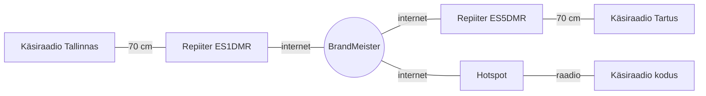

DMR (*Digital Mobile Radio*) on digitaalne raadiosidestandard, mida kasutavad nii ametiasutused ja ettevõtted kui ka raadioamatöörid. See leht selgitab, kuidas DMR töötab, mis on repiiter ning kuidas pääseda Eesti DMR-võrku.

> **Lühidalt:** DMR jagab ühe kanali kaheks timeslot'iks (TS1 ja TS2), nii et repiiter kannab korraga kahte kõnet. Internetti ühendatud repiiterite kaudu saab käsiraadioga rääkida üle Eesti ja kogu maailma. Alustamiseks on vaja raadioamatööri kutsungit, tasuta DMR ID-d ja DMR-raadiot.
{.is-info}

# Mis on DMR?

DMR on Euroopa Telekommunikatsioonistandardite Instituudi (ETSI) avatud standard (**ETSI TS 102 361**), mis ilmus 2005. aastal. Kuna standard on avatud, suhtlevad eri tootjate raadiojaamad omavahel — sama võrku saab kasutada nii Motorola, Hytera, AnyTone kui ka TYT raadioga. Raadioamatöörid kasutavad DMR-i peamiselt 70 cm (430–440 MHz) ja 2 m (144–146 MHz) sagedusalas.

## Kuidas DMR töötab

- **Digitaalne kõne.** Hääl kodeeritakse vokoodriga (AMBE+2) kompaktseks andmevooks ja edastatakse digitaalselt koos saatja andmetega.
- **Kaks timeslot'i (TDMA).** 12,5 kHz kanal jagatakse kaheks vahelduvaks timeslot'iks — **TS1** ja **TS2**. Kumbki slot kannab eraldi kõnet, seega mahub ühele sagedusele korraga kaks teineteist segamata vestlust.
- **Modulatsioon** on 4FSK, andmekiirus 9600 bit/s.

```
aeg ──────────────────────────────────────────────►
┌─────────┬─────────┬─────────┬─────────┬─────────┐
│   TS1   │   TS2   │   TS1   │   TS2   │   TS1   │
│ kõne A  │ kõne B  │ kõne A  │ kõne B  │ kõne A  │
└─────────┴─────────┴─────────┴─────────┴─────────┘
  30 ms     30 ms     …
```

Kuna käsiraadio saatja töötab vaid oma slotis ehk pool ajast, kulub aku märgatavalt aeglasemalt kui analoog-FM-i puhul.

## DMR Tier'id

| Tier | Kasutus | Märkus |
|---|---|---|
| **Tier I** | Litsentsivaba side 446 MHz sagedusalas (PMR446) | Väike võimsus, ilma repiiteriteta |
| **Tier II** | Tavaline litsentseeritud DMR, repiiterid, 2 timeslot'i | **Seda kasutavad raadioamatöörid** |
| **Tier III** | Trunking-võrgud, kus süsteem jagab kanaleid automaatselt | Peamiselt ametkondlik ja ettevõtete side |

## DMR võrreldes analoog-FM-iga

| | Analoog FM | DMR |
|---|---|---|
| Kõnesid kanali kohta | 1 | 2 (TS1 ja TS2) |
| Nõrk signaal | kahin kasvab järk-järgult | heli jääb puhtaks, kuni side järsult katkeb |
| Saatja tuvastamine | ainult suuliselt öeldud kutsungi järgi | raadio saadab DMR ID automaatselt, vastuvõtja ekraanil kuvatakse kutsung |
| Side ulatus | repiiteri levi piires | internetiga ühendatud repiiterite kaudu üle kogu maailma |
| Lisavõimalused | — | SMS, GPS-asukoht, private call |
| Seadistamine | lihtne: sagedus ja vajadusel CTCSS | keerukam: tuleb koostada codeplug |

# Põhimõisted

DMR-is kohtad mõisteid, mida FM-is pole. Raadiote menüüdes ja programmeerimistarkvaras on need enamasti inglise keeles, seepärast kasutame ka siin samu termineid.

**DMR ID** — seitsmekohaline isiklik number, mis on seotud sinu kutsungiga. Raadio saadab selle iga saatega kaasa. ID taotletakse tasuta [RadioID.net](https://radioid.net) lehel. Eesti kasutajate ID-d algavad numbritega **248** (Eesti riigikood). Repiiteritel on kuuekohaline ID, näiteks ES1DMR-il 248001.

**Talkgroup (TG)** — „virtuaalne kanal", mille kaudu räägid kindla grupiga. Näiteks TG 248 on kogu Eesti ja TG 91 kogu maailm. Kõik, kes on samal TG-l, kuulevad üksteist, olenemata sellest, millise repiiteri kaudu nad ühendatud on.

**Timeslot (TS1/TS2)** — kumba kahest slotist kanal kasutab. Repiiteri sysop otsustab, millised TG-d millisel slotil käivad.

**Color Code (CC)** — number 0–15, mis toimib sarnaselt FM-i CTCSS-toonile: repiiter võtab vastu ainult õige CC-ga signaali. Kõik Eesti DMR-repiiterid kasutavad praegu **CC 1**.

**Group call ja private call** — group call läheb kogu TG-le ja seda kuulevad kõik selle TG kasutajad. Private call on suunatud ühele DMR ID-le: inimesele või teenusele, näiteks parrot'ile.

**Kanal** — DMR-raadios koondab kanal kõik vajaliku ühte kohta:

> **Kanal = sagedus + color code + timeslot + TG**

**RX Group List** — TG-d, mida raadio sellel kanalil kuulab. Kui TG nimekirjas puudub, jääb raadio vaikseks ka siis, kui repiiter seda kõnet edastab.

**Zone** — kanalite kogum, näiteks „Tallinn" või „Hotspot". Aitab kanaleid hallata.

**Codeplug** — raadio kogu seadistus (ID, kontaktid, kanalid, zone'id). See koostatakse arvutis programmeerimistarkvaraga (CPS) ja laetakse raadiosse.

# Repiiter

## Mis on repiiter?

Repiiter on kõrgel asukohal (mastis, katusel) paiknev raadiojaam, mis võtab signaali vastu ühel sagedusel (**sisend**) ja saadab selle samal ajal teisel sagedusel (**väljund**) uuesti välja. Kõrge antenn ja suurem võimsus pikendavad käsiraadio levi mõnelt kilomeetrilt kümnete kilomeetriteni.

Sisend- ja väljundsageduse vahe on **shift**. Eesti 70 cm DMR-repiiteritel on shift enamasti 7,6 MHz, 2 m repiiteritel 0,6 MHz.

Käsiraadiosse sisestatakse sagedused vastupidi:

- raadio **RX-sagedus** = repiiteri **väljund**
- raadio **TX-sagedus** = repiiteri **sisend**

> Sagedusnimekirjades on „TX" ja „RX" sageli antud **repiiteri** vaatenurgast. Kontrolli alati, kumba pidi tabel on koostatud — vale suund on levinuim põhjus, miks raadio repiiterit ei ava.
{.is-warning}

## DMR-repiiteri eripärad

- **Kaks kõnet korraga.** DMR-repiiter edastab mõlemat slotti samaaegselt: TS1-l võib käia üks vestlus ja TS2-l samal ajal teine.
- **Color code** peab raadios ja repiiteris kattuma.
- **Võrguühendus.** Enamik DMR-repiitereid on interneti kaudu ühendatud keskse serveriga. Eestis kasutatakse peamiselt **BrandMeister** võrku. Server suunab iga TG liikluse kõigile repiiteritele ja hotspotidele, kus see TG on parajasti aktiivne.



## Static ja dynamic TG-d

- **Static TG** on repiiteril alati aktiivne — selle seadistab sysop. Seda kuuleb repiiteril ka siis, kui keegi kohapeal pole seda TG-d kasutanud.
- **Dynamic TG** aktiveerub, kui keegi repiiteri levialas sellele TG-le saadab. Pärast teatud aja vaikust (sõltub repiiterist, tavaliselt kuni ~15 minutit) ühendatakse see automaatselt lahti.

> Dynamic TG hõivab repiiteri sloti **kõigi** kasutajate jaoks. Kui oled vestluse lõpetanud, tee samal slotil lühike group call **TG 4000**-le — see teeb unlink'i ja vabastab sloti.
{.is-info}

## Hotspot

Hotspot on väike isiklik „minirepiiter" (tavaliselt MMDVM-plaat koos Raspberry Pi ning Pi-Star või WPSD tarkvaraga), mis ühendab sinu raadio kodu interneti kaudu DMR-võrku. Selle võimsus on väga väike ja levi jääb enamasti maja või krundi piiresse — see on mõeldud olukordadeks, kus repiiter ei ulatu. Simplex-hotspot kasutab ühte sagedust ja tavaliselt ainult TS2-e.

# DMR Eestis

Eesti DMR-repiiterid on ühendatud peamiselt **BrandMeister** võrku. Eesti DMR-info — repiiterite nimekiri, juhendid ja üritused — on koondatud lehele [dmr.ee](https://www.dmr.ee). Repiiterite ja raadiosidevõrkude hooldust ja arendust koordineerib ERAÜ Raadiosidevõrkude toimkond.

## Olulised TG-d

| TG | Nimi | Märkus |
|---|---|---|
| **248** | Estonia | Eesti üleriigiline TG, peamine koht Eesti-siseseks suhtluseks |
| 2480–2488 | Regionaalsed | Kutsungi numbri järgi: 2480 = ES0 … 2488 = ES8 (nt 2485 = Tartu piirkond) |
| 24804 | Narva | ES4 Narva piirkond |
| 24810 | Estonia-RUS | Venekeelne TG |
| 91 | Worldwide | Ülemaailmne, väga aktiivne — sobib vaid lühikesteks kõnedeks |
| 92 | Europe | Üleeuroopaline |
| 9 | Local | Jääb ühe repiiteri või hotspoti piiresse |
| 99 | Simplex | Raadiolt raadiole ilma repiiterita |
| 4000 | Unlink | Group call; ühendab dynamic TG-d lahti |
| 9990 | Parrot | **Private call**; mängib sinu saate tagasi, et kuuleksid oma signaali ja heli |

## Repiiterid (seisuga 1. oktoober 2026)

> Tabel on hetkeseis. Repiiterid, sagedused ja TG-de jaotus muutuvad — kehtiva nimekirja leiad lehelt [dmr.ee/repiiterid](https://www.dmr.ee/repiiterid/) ja reaalajas staatuse [BrandMeisteri](https://brandmeister.network) lehelt.
{.is-warning}

Sagedused on antud **käsiraadio** vaatenurgast: *Raadio RX* = repiiteri väljund, *Raadio TX* = repiiteri sisend. Kõigi repiiterite color code on 1.

| Kutsung | Asukoht | Raadio RX | Raadio TX | Shift | Märkused |
|---|---|---|---|---|---|
| ES1DMR | Tallinn | 434,5875 MHz | 432,5875 MHz | −2,0 MHz | Levi ~25 km. TS1: TG 24804, TS2: TG 248. Parrot: private call 244997. Ka FM (CTCSS 82,5 Hz) |
| ES3DMR | Rapla | 438,8000 MHz | 431,2000 MHz | −7,6 MHz | Väljundvõimsus 1,8 W |
| ES3DMRA | Märjamaa | 438,7500 MHz | 431,1500 MHz | −7,6 MHz | Ka FM (CTCSS 82,5 Hz) |
| ES4RUN | Narva | 438,7250 MHz | 431,1250 MHz | −7,6 MHz | Ka ADN Systems võrk. Ka FM (CTCSS 88,5 Hz) |
| ES4RVN | Narva | 145,6750 MHz | 145,0750 MHz | −0,6 MHz | 2 m repiiter, levi ~Valasteni. TS1: TG 248, TS2: TG 24804. Ka FM (CTCSS 88,5 Hz) |
| ES5DMR | Tartu | 438,9750 MHz | 431,3750 MHz | −7,6 MHz | |
| ES8DMR | Lihula | 438,6500 MHz | 431,0500 MHz | −7,6 MHz | Ka FM (CTCSS 67,0 Hz) |

## Eesti DMR NET

Esmaspäeviti kell 20.00 toimub **TG 248**-l Eesti DMR NET — ümarlaud, kus saab end kirja panna, nõu küsida ja oma seadmeid proovida. Uutele tulijatele on see hea koht esimeseks sideks. Täpsem info: [dmr.ee/dmr-net](https://www.dmr.ee/dmr-net/).

# Kuidas alustada

1. **Raadioamatööri tunnistus ja kutsung.** Raadioamatööride sagedustel saatmiseks on vaja kehtivat tunnistust ja kutsungit, mida väljastab Tarbijakaitse ja Tehnilise Järelevalve Amet (TTJA). Kuulata võid ka ilma selleta.
2. **DMR ID.** Registreeri end [RadioID.net](https://radioid.net) lehel. Vajad kutsungit ja tunnistuse koopiat; kinnitamine võib võtta mõne päeva.
3. **DMR-raadio.** Sobib iga Tier II toega raadio amatööride sagedusalale. Levinud valikud on näiteks AnyTone ja TYT/Retevis käsiraadiod; osale neist saab paigaldada ka vaba püsivara (nt OpenGD77).
4. **Codeplug.** Sisesta raadiosse oma DMR ID ja kutsung, lisa kontaktidesse vajalikud TG-d, loo lähima repiiteri kanalid ja pane need ühte zone'i. Tasub laadida raadiosse ka RadioID kasutajate andmebaas — siis näitab ekraan vastaja kutsungit ja nime.
5. **Testi parrot'iga.** Tee private call numbrile 9990 (või repiiteri soovitatud parrot'ile) ja kuula, kuidas su saade kõlab.
6. **Esimene side.** Kuula TG 248-t ja anna teada, et kuulad — või tule esmaspäevasesse DMR NET-i.
7. **Valikuline:** loo [BrandMeister SelfCare](https://brandmeister.network) konto. Seda on vaja hotspoti seadistamiseks ja oma static TG-de haldamiseks.

## Näide: kanal ES1DMR-i jaoks

Väljade nimed on toodud nii, nagu need on enamikus CPS-ides.

| Väli | Väärtus | Selgitus |
|---|---|---|
| Channel Name | ES1DMR 248 | Vali ise |
| Channel Type | Digital | |
| RX Frequency | 434,5875 MHz | Repiiteri väljund |
| TX Frequency | 432,5875 MHz | Repiiteri sisend |
| Color Code | 1 | |
| Time Slot | 2 | ES1DMR-il käib TG 248 TS2-l |
| TX Contact | TG 248 (group call) | Kellele saadad |
| RX Group List | TG 248 | Mida kuulad |
| Admit Criteria | Channel Free | Raadio ei lase saata, kui slot on hõivatud |

# Head tavad eetris

- **Oota pärast PTT vajutamist umbes sekund**, enne kui rääkima hakkad. Võrgul kulub ühenduse loomiseks hetk, muidu jääb esimene sõna kuulmata.
- **Tee saadete vahel 2–3-sekundiline paus**, et teised — sealhulgas hädaolukorras — saaksid vahele tulla.
- **Nimeta oma kutsung** ja vajadusel TG, näiteks „ES1ABC kuulab TG 248-l".
- **Suured TG-d** (91, 92, 248) on ühiseks kasutuseks. Pikema vestluse jaoks leppige kokku ja liikuge regionaalsele või vähem kasutatud TG-le.
- **Tee unlink** (TG 4000), kui oled dynamic TG-l vestluse lõpetanud.
- **Testimiseks kasuta parrot'it**, mitte tühja PTT-vajutust repiiterile.
- **Ära krüpteeri.** Raadioamatööride sagedustel ei tohi sidet krüpteerida — kontrolli, et krüpteerimine on raadios välja lülitatud.

# Sõnastik

| Termin | Selgitus |
|---|---|
| AMBE+2 | DMR-is kasutatav vokooder, mis kodeerib häält |
| BrandMeister | Suurim ülemaailmne raadioamatööride DMR-võrk |
| Codeplug | Raadio kogu seadistus: ID, kontaktid, kanalid, zone'id |
| Color Code (CC) | Repiiteri „pääsukood" vahemikus 0–15 |
| CPS | Raadio programmeerimistarkvara (*Customer Programming Software*) |
| Group call | Kõne kogu TG-le |
| Hotspot | Isiklik väikese võimsusega pääs DMR-võrku |
| MMDVM | Levinud avatud riist- ja tarkvara repiiterite ja hotspotide jaoks (*Multi-Mode Digital Voice Modem*) |
| Parrot | Teenus, mis mängib sinu saate tagasi (echo test) |
| Private call | Kõne ühele DMR ID-le |
| Repiiter | Raadiojaam, mis saadab vastuvõetud signaali teisel sagedusel edasi |
| RX Group List | TG-d, mida raadio kanalil kuulab |
| SelfCare | BrandMeisteri kasutajakonto seadete haldus |
| Shift | Repiiteri sisend- ja väljundsageduse vahe |
| Static / dynamic TG | Alati aktiivne TG / kasutamisel aktiveeruv TG |
| Sysop | Repiiteri omanik ja haldaja |
| Talkgroup (TG) | Grupp, kellega räägid; „virtuaalne kanal" |
| Timeslot (TS1/TS2) | Üks kahest DMR-kanali ajalõigust |
| Unlink | Dynamic TG lahtiühendamine (TG 4000) |
| Zone | Kanalite kogum raadios |

# Lisalugemist

- [DMR.ee *Eesti DMR-võrgu teated, juhendid ja repiiterid*](https://www.dmr.ee)
- [DMR-iga alustamine *Samm-sammult juhend lehel dmr.ee*](https://www.dmr.ee/alustamine/)
- [BrandMeister *Võrgu koduleht, repiiterite ja TG-de staatus*](https://brandmeister.network)
- [BrandMeister Wiki: Estonia *Eesti TG-d ja koordinaatorid*](https://wiki.brandmeister.network/index.php/Estonia)
- [RadioID.net *DMR ID taotlemine*](https://radioid.net)
- [ERAÜ raadiosidevõrgud *Eesti repiiterite koordineerimine*](https://www.erau.ee/et/raadiosidevorgud)
{.links-list}